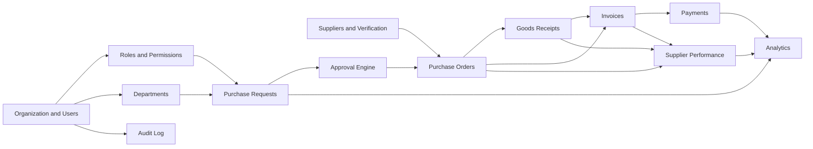

# 01. Product Feature Specification

## 1. Roles and capabilities

| Role | Key capabilities |
|------|------------------|
| Organization Owner | Org settings, departments, invite users, configure roles/permissions and approval policies, org-wide analytics, audit log access |
| Procurement Manager | Supplier CRUD and verification, review requests, create POs, manage workflows, supplier performance |
| Department Manager | Create requests, approve/reject within assigned limit, departmental spend view |
| Finance Officer | Review POs, record and match invoices, resolve discrepancies, record payments, spend monitoring |
| Employee | Submit requests, track status, view own PO info, comment/communicate on requests |

Roles are **data** (rows with permission sets), so owners can create custom roles. The five above are seeded system roles per organization.

## 2. Features

### Core (MVP)
- **Tenant and identity:** organization signup, invitations, login, departments, RBAC.
- **Supplier management:** registration, profile, categories, document upload, verification (pending → verified/rejected), status (active/suspended/blacklisted).
- **Purchase requests:** name, description, quantity, estimated cost, department, priority, required delivery date. Draft → submitted.
- **Approval engine:** configurable amount-band rules producing sequential multi-stage approvals; approve/reject with comment; delegation-ready.
- **Purchase orders:** created from approved requests, supplier assignment, line items, status lifecycle, delivery receipts, history.
- **Invoices and payments:** record invoice, automatic match against PO and receipts, discrepancy records, payment recording, payment history.
- **Audit log:** append-only record of every state change.
- **In-app and email notifications.**
- **Basic analytics:** total spend, by department, by supplier, pending requests, approval time.

### Secondary
- Supplier performance scoring (delivery, completion, discrepancy rate) with trend view.
- Request comments and attachments.
- Saved filters, CSV export.
- Approval delegation and out-of-office.

### Future
- Risk indicators from external data, RFQ/bidding, contract lifecycle, budgets with commitment tracking, multi-currency with FX, ERP and accounting integrations, SSO/SAML, supplier self-service portal, ML anomaly detection.

## 3. Business rules
1. A request cannot become a PO until every approval step is approved.
2. Only `verified` and `active` suppliers can be assigned to a PO.
3. Approver cannot approve their own request (segregation of duties).
4. Approval rules are chosen by estimated cost, optionally scoped by department; rule bands must not overlap within a workflow.
5. A PO total is the sum of its items; it may deviate from the estimate only within an org-configured tolerance, otherwise it re-triggers approval.
6. Invoice is matched to PO (and received quantity). Differences beyond tolerance create a discrepancy that blocks payment until resolved.
7. Payments cannot exceed the invoice amount; an invoice cannot exceed what is unpaid on the PO beyond tolerance.
8. Submitted requests are immutable except by cancellation; edits create a new revision.
9. Approval steps are a **snapshot**; changing policy does not alter in-flight requests.
10. Every mutation writes an audit record. Audit records are never updated or deleted.
11. All data is scoped to one organization; cross-tenant access is impossible by construction.

## 4. Feature dependencies

## 5. MoSCoW prioritization matrix

| Feature | Must | Should | Could | Won't (for now) |
|---------|:----:|:------:|:-----:|:---------------:|
| Org, users, invites, departments | ✔ | | | |
| RBAC with seeded roles | ✔ | | | |
| Custom role editor | | ✔ | | |
| Supplier CRUD, documents, verification | ✔ | | | |
| Purchase requests | ✔ | | | |
| Configurable approval rules | ✔ | | | |
| Approval delegation | | ✔ | | |
| Purchase orders and items | ✔ | | | |
| Goods receipts / delivery tracking | ✔ | | | |
| Invoice recording and 3-way match | ✔ | | | |
| Payment tracking | ✔ | | | |
| Audit logs | ✔ | | | |
| Email and in-app notifications | | ✔ | | |
| Spend analytics (basic) | ✔ | | | |
| Supplier performance scoring | | ✔ | | |
| Request comments/attachments | | ✔ | | |
| CSV/PDF exports | | | ✔ | |
| Real-time websocket updates | | | ✔ | |
| Risk indicators from external feeds | | | | ✔ |
| RFQ/bidding, contract lifecycle | | | | ✔ |
| Budgets and commitments | | | | ✔ |
| Multi-currency FX | | | | ✔ |
| ERP integration, SSO | | | | ✔ |
| Supplier portal | | | | ✔ |
| ML anomaly detection | | | | ✔ |

## 6. System limitations (current design)
- Single currency per organization in MVP (amounts stored with currency code to allow later FX).
- Sequential approval stages only; parallel branches and conditional routing are limited to "any one / all of" per stage.
- Single-line purchase request; multi-item lives at PO level.
- Risk indicators are internal-data-derived only (late deliveries, discrepancies, document expiry).
- Payments are recorded, not executed; no bank integration.
- Shared-database tenancy means noisy-neighbour risk until partitioning or dedicated tenants are introduced.
