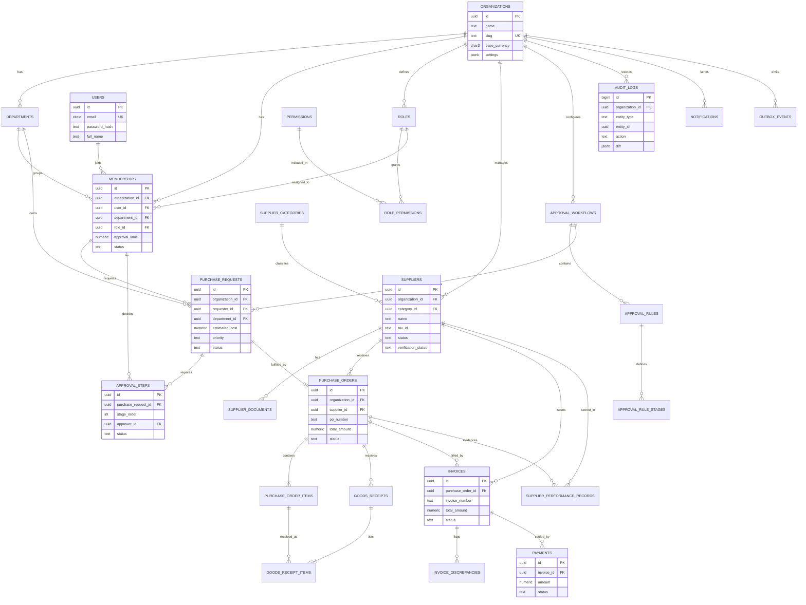

# 03. Entity Relationship Diagram

Every tenant-owned table carries `organization_id`. Rows are shown with key columns only; full definitions are in document 04.

## Relationship explanations
- **Users are global; memberships are tenant-scoped.** One person can belong to several organizations with different roles/departments. Every authorization decision resolves through a membership, never through the user alone.
- **Roles belong to an organization** (custom roles); `permissions` is a global catalogue of capabilities (`request:create`, `po:issue`, …) mapped by `role_permissions`.
- **Workflow definition vs. instance:** `approval_workflows → approval_rules → approval_rule_stages` is the configurable template. `approval_steps` is the frozen per-request instance.
- **Request to PO is 1 to 0..1** in MVP (one approved request yields at most one PO). Relaxing to many is a unique-constraint change.
- **PO to invoices is 1 to many** (partial billing). **Invoice to payments is 1 to many** (instalments).
- **Goods receipts** are separate from PO items so partial deliveries and received quantities (needed for the 3-way match and delivery KPIs) are first-class facts.
- **Performance records** are derived, append-only facts per PO event (on-time, complete, discrepancy), rolled up into period scores.
