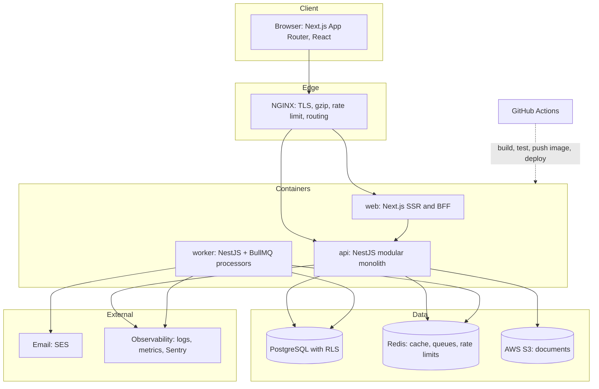
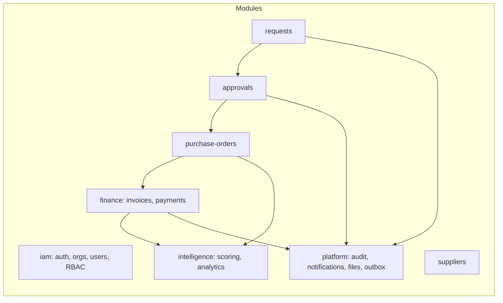

# 05. Application Architecture

## Decision: Modular Monolith

| Option | Verdict | Reasoning |
|--------|---------|-----------|
| **Modular monolith** | **Chosen** | One deployable, strict module boundaries. Procurement flows (approve → PO → invoice → pay) need ACID transactions across modules; in-process calls and one database give that for free. Small team, one release cadence, no module with independent scaling needs yet. |
| Microservices | Rejected for now | Would turn "approve request and create PO" into a distributed saga with compensation, add network failure modes, per-service CI/CD and observability, all before any proven scaling pain. |
| SOA | Rejected | Shared enterprise service bus and coarse services bring the coordination overhead of microservices without the clean ownership. |

Escape hatch: modules communicate only through public interfaces and domain events, so analytics, notifications or document processing can be extracted later.

## High-level architecture

## Backend module structure (NestJS, Clean Architecture per module)

Each module has four layers:
- **domain:** entities, value objects (`Money`, `PoNumber`), state machines, domain events. No framework imports.
- **application:** use cases (`SubmitPurchaseRequest`, `RecordPayment`), ports (interfaces).
- **infrastructure:** Drizzle repositories, S3 adapter, BullMQ adapter implementing ports.
- **presentation:** controllers, DTOs (validated with class-validator or Zod), guards.

SOLID in practice: single-purpose use cases (S); new approver types are new strategy classes, not edits to the engine (O); repositories are substitutable behind interfaces for unit tests (L); small ports such as `FileStore`, `Mailer` (I); use cases depend on ports, never on Drizzle or AWS (D). Modules never import each other's internals, only exported facades and events.

## Frontend architecture
- **Next.js (App Router) + TypeScript.** Server components for read-heavy lists and dashboards; client components for forms, approval actions, filters.
- **Data fetching:** TanStack Query on the client with typed API client generated from the OpenAPI spec; server actions avoided for business mutations so the API stays the single source of truth.
- **Auth in the web tier:** httpOnly cookies, middleware route protection, permission-aware UI (hide, never trust).
- **Structure:** feature folders (`features/requests`, `features/suppliers`, …), shared UI kit, form schemas shared with the API through a `packages/contracts` workspace (Zod).
- **UX:** role-aware dashboards, inbox for approvals, optimistic updates only for low-risk actions.

## API structure
REST over JSON, versioned at `/api/v1`, documented with OpenAPI (Swagger). Details in document 07. REST is chosen over GraphQL because resources and state transitions map naturally to nouns and verbs, caching and rate limiting are simpler, and clients are few.

## Authentication
- Email + password (Argon2id), email verification, optional TOTP MFA.
- **Short-lived JWT access token (10–15 min)** + **rotating refresh token** (hashed in DB, reuse detection, revocable per device) in httpOnly, Secure, SameSite cookies.
- Token carries `userId`, active `organizationId`, and `membershipId`; switching organization issues a new token.
- Rate limiting and lockout on login via Redis. Invitation tokens are single-use, hashed, expiring.
- Future: SSO/SAML/OIDC per organization.

## Authorization
Layered checks, all server-side:
1. **Authentication guard:** valid token.
2. **Tenant guard:** sets tenant context, RLS variable.
3. **Permission guard (RBAC):** `@RequirePermission('po:issue')` resolved from role to permission set (cached in Redis, invalidated on role change).
4. **Policy layer (ABAC-style) in use cases:** ownership and limits, e.g. employees see only their own requests, department managers only their department, approver limit ≥ amount, no self-approval, supplier must be verified.
5. **Database:** RLS as the last line.

## Database communication
Drizzle ORM with `postgres`/`pg` pool; one transaction per use case via a `UnitOfWork` abstraction; PgBouncer in transaction mode once connections grow; migrations via drizzle-kit, run as a gated CI/CD step. Complex analytics use hand-written SQL through Drizzle's `sql` template.

## File and document storage
S3 private bucket, SSE-KMS encryption, versioning on. Upload via pre-signed PUT (client → S3 directly), then the API records metadata and a checksum; an async job runs content-type and malware scan before the document is marked reviewable. Download via short-lived pre-signed GET after a permission check. Local MinIO in development; on a plain VPS, S3-compatible storage works the same.

## Notification system
Domain events written to `outbox_events` in the same transaction as the state change. A relay worker publishes them to BullMQ; handlers create in-app `notifications` and send email (SES) with templates and retries. User-level preferences control channels. WebSocket/SSE push is a Could-Have layered on the same events.

## Background processing
BullMQ on Redis, separate `worker` container. Queues: `notifications`, `documents` (scan, expiry checks), `scoring` (supplier score recalculation), `reports` (exports), `escalations` (approval SLA reminders, repeatable jobs). Jobs are idempotent, with exponential-backoff retries and a dead-letter queue visible to admins.

## Caching strategy
| What | Where | TTL / invalidation |
|------|-------|--------------------|
| Role → permissions | Redis | invalidate on role edit |
| Org settings, approval rules | Redis + in-process LRU | invalidate on change |
| Analytics aggregates | Redis / materialized views | 5–15 min, refreshed by jobs |
| Reference data (categories, departments) | Client cache via TanStack Query | stale-while-revalidate |
Never cached: approval state, balances, anything used for a financial decision. Postgres stays the source of truth.

## Deployment topology
- **MVP:** Docker Compose on a VPS (or one EC2): `nginx`, `web`, `api`, `worker`, `postgres` (or RDS), `redis`. NGINX terminates TLS (Let's Encrypt), proxies `/api` to `api` and everything else to `web`.
- **Growth:** AWS: ALB, ECS Fargate for web/api/worker, RDS PostgreSQL (Multi-AZ), ElastiCache, S3, CloudWatch.
- **CI/CD (GitHub Actions):** lint → typecheck → unit tests → integration tests (Postgres + Redis service containers) → build images → push to registry → run migrations → deploy with health-checked rolling restart → smoke test.

## Technology: used vs. deferred
| Use now | Defer / not needed initially |
|---------|-----------------------------|
| TypeScript, Next.js, NestJS, PostgreSQL, Drizzle, Redis (queues + cache), Docker, NGINX, GitHub Actions, S3 | Express (NestJS already wraps it), Kubernetes, microservices, message broker (Kafka/RabbitMQ), search engine (Elasticsearch), GraphQL, multi-region |

## Testing strategy
- **Unit:** domain state machines, approval rule selection, three-way match, Money maths (fast, no DB).
- **Integration:** use cases against real Postgres (Testcontainers), including RLS and constraints.
- **API/contract:** supertest against OpenAPI; role-by-endpoint permission matrix tests; **cross-tenant leakage tests**.
- **E2E:** Playwright for the three key journeys.
- **Non-functional:** k6 load tests on list and dashboard queries; concurrency tests for double-approval and double-payment races.
