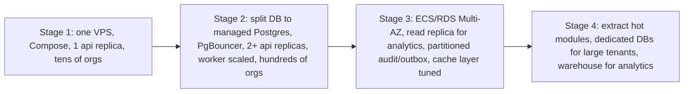

# 10. Risk and Scalability Analysis

## 1. Risk register
| # | Risk | Likelihood | Impact | Mitigation |
|---|------|:---:|:---:|------------|
| 1 | Cross-tenant data leak | Low | Critical | Tenant-bound repositories, RLS, composite FKs, S3 prefixes, automated leakage tests, non-owner DB role |
| 2 | Overpayment or duplicate payment | Med | High | Three-way match, row locks, idempotency keys, unique invoice constraint, CHECK on amounts |
| 3 | Approval bypass or self-approval | Med | High | Server-side policy checks, segregation of duties, snapshot steps, audit trail |
| 4 | Misconfigured approval rules (gaps, overlaps) | Med | Med | EXCLUDE constraint, rule validation, simulate endpoint, default fallback rule |
| 5 | Lost notifications or events | Med | Med | Transactional outbox, idempotent retries, dead-letter queue and alerting |
| 6 | Malicious or incorrect supplier documents | Med | Med | Type/size limits, async malware scan, signed URLs, manual verification, checksum |
| 7 | Credential theft | Med | High | Argon2id, MFA option, short JWT TTL, refresh rotation with reuse detection, rate limiting and lockout |
| 8 | Data loss | Low | Critical | PITR backups, tested restores, S3 versioning, no hard deletes of financial data |
| 9 | Single-host outage (VPS stage) | Med | Med | Health checks, auto-restart, backups, documented move to multi-AZ managed services |
| 10 | Tenant noisy neighbour | Med | Med | Rate limits per org, statement timeouts, partitioning, dedicated DB for large tenants |
| 11 | Boundary erosion in the monolith | Med | Med | Lint rules on imports, module facades, code review checklist |
| 12 | Redis outage | Low | Med | Graceful degradation, outbox in Postgres, cache fallback to DB |
| 13 | Scope creep from "enterprise" asks | High | Med | MoSCoW discipline, extension hooks instead of early features |
| 14 | Regulatory (GDPR, data residency, financial audit) | Med | High | Audit logs, retention policies, encryption at rest and in transit, region-pinned deployments as future option |

## 2. Security controls summary
TLS everywhere (NGINX/ALB), secrets in environment/secret manager, encrypted storage (RDS, S3 SSE-KMS), least-privilege IAM, dependency scanning and image scanning in CI, input validation, parameterized queries through Drizzle, CSRF protection for cookie flows, security headers, structured logs without PII or secrets.

## 3. Scalability path

| Dimension | Strategy |
|-----------|----------|
| Traffic | Stateless API replicas behind NGINX/ALB; CDN for static web assets |
| Data volume | Partition append-only tables; archive closed records; keyset pagination |
| Read-heavy analytics | Rollups, materialized views, read replica, then warehouse |
| Writes | Short transactions, narrow locks, batched background work |
| Organizational growth | Tenant routing allows moving big organizations to their own DB |
| Operational | Metrics (latency, queue depth, lock waits), alerts, load tests before each stage |

## 4. Fault tolerance
Retries with backoff for jobs, idempotent handlers, health and readiness probes, graceful shutdown to finish in-flight transactions, database failover in Multi-AZ stage, documented RPO/RTO targets (e.g. RPO ≤ 5 min via WAL archiving, RTO ≤ 1 hour).

## 5. Known limitations of this design
1. Shared-database tenancy cannot give physical isolation without moving to a dedicated tenant DB.
2. Approval engine handles amount-band, sequential workflows, not arbitrary parallel/conditional graphs.
3. Per-org gap-free numbering serializes PO creation within one organization.
4. Single currency per organization in MVP.
5. Analytics freshness is minutes, not real time.
6. Payments are recorded rather than executed; no bank reconciliation yet.
7. Early deployment has a single point of failure until managed services are adopted.
8. Supplier risk is based on internal behaviour only; no external intelligence.
